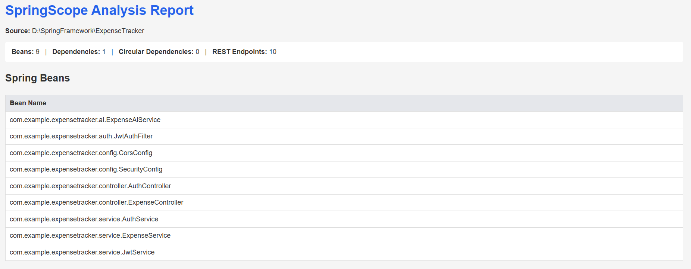
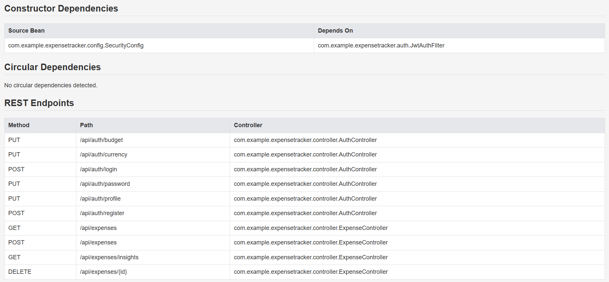

# SpringScope — Spring Boot Source Analyzer

SpringScope is a Java-based source code analyzer designed to inspect Spring Boot applications and generate an HTML analysis report. It uses JavaParser to analyze Java source files and PostgreSQL to store analysis results.

## Features

- Detects Spring beans using annotations such as `@Component`, `@Service`, `@Repository`, `@Controller`, and `@RestController`.
- Identifies constructor-based dependencies between beans.
- Detects circular dependencies.
- Extracts REST endpoints and their mapping annotations.
- Saves analysis results in PostgreSQL.
- Generates an HTML report containing analysis results and summary information.

## Technology Stack

- Java 21
- Spring Boot
- JavaParser
- PostgreSQL
- HTML and CSS

## Prerequisites

Install the following before running SpringScope:

1. **Java JDK 21**
2. **Apache Maven 3.9 or later**
3. **PostgreSQL**


## Database Setup

### 1. Create the PostgreSQL Database

Open PostgreSQL using pgAdmin or `psql` and execute:

```sql
CREATE DATABASE springscope;
```

### 2. Configure Database Username and Password

Open `src/main/resources/application.properties` and configure:

```properties
spring.datasource.url=jdbc:postgresql://localhost:5432/springscope
spring.datasource.username=${DB_USERNAME:postgres}
spring.datasource.password=${DB_PASSWORD}
spring.main.web-application-type=none
```

### 3. Set Credentials on Windows

Open PowerShell and run:

```powershell
$env:DB_USERNAME = "postgres"
$env:DB_PASSWORD = "your_database_password"
```

## How to Run SpringScope

### Step 1: Navigate to the Project Directory

```powershell
cd D:\SpringFramework\SpringScope
```

### Step 2: Compile the Project

```bash
mvn clean compile
```

### Step 3: Analyze a Spring Boot Application

Provide the path to the target application's Java source directory:

```bash
mvn spring-boot:run "-Dspring-boot.run.arguments=D:/Projects/MySpringApp/src/main/java"
```

Replace the example path with the actual `src/main/java` directory of the application you want to analyze.


## HTML Report

The report is generated at:

`target/springscope-report.html`

The report includes:

- Detected Spring beans
- Constructor dependencies
- Circular dependency information
- REST endpoint details

## Screenshots

This screenshot shows the HTML report generated by SpringScope.



